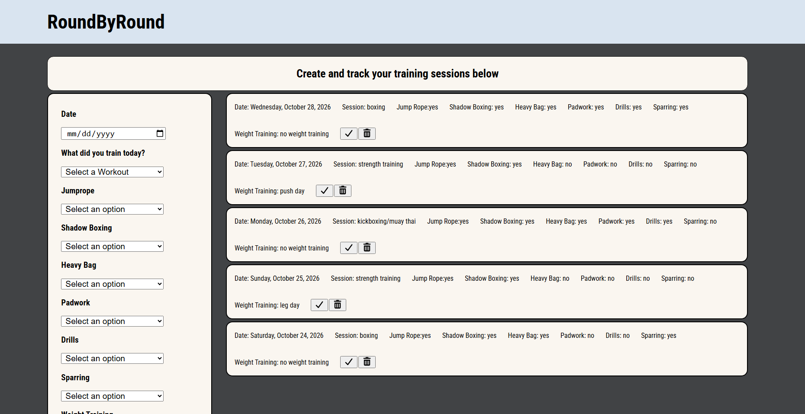

# RoundByRound

RoundByRound is a training session tracker for combat sports. Log each workout with the date, session type, and what you worked on, then mark sessions complete or delete them as you go.

## Demo



## Features

- Create a training session with a date, session type, and details like jump rope, shadow boxing, heavy bag, padwork, drills, sparring, and weight training.
- View all sessions on the page, listed line by line.
- Mark a session as completed.
- Delete any session, completed or not.

## Built with

- Node.js and Express
- MongoDB
- Plain JavaScript, HTML, and CSS

## Getting started

### Prerequisites

- Node.js and npm
- A MongoDB database and connection URI

### Installation

1. Clone the repository and move into the project directory.
2. Install the dependencies:

   ```
   npm install
   ```
3. Create a `.env` file in the project root and add your MongoDB connection URI:

   ```
   DB_STRING=mongodb+srv://<username>:<password>@<cluster>/<database>?retryWrites=true&w=majority
   ```

   Replace the URI placeholders with your database connection details.
4. Start the server:

   ```
   node server.js
   ```
5. Open [http://localhost:8080](http://localhost:8000) in your browser.

## Using the app

Pick a date, choose the type of workout, and fill in what you did in the session, then submit the form to add it to your list. Use the check button on a session to mark it complete, or the trash button to delete it.
